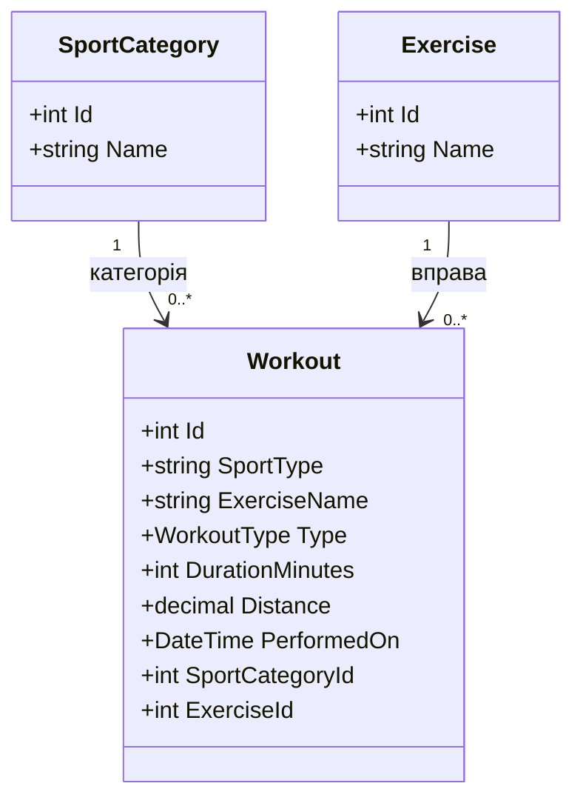

# Щоденник тренувань (TrainingDiary)

## Лабораторна робота №2
Тема: Мова C# і модель предметної області.

## Опис проєкту
TrainingDiary — вебзастосунок Blazor для ведення щоденника тренувань, обліку вправ та аналізу фізичної активності.

## Модель предметної області
Клас Workout містить такі властивості:
- Id (int) — ідентифікатор тренування.
- SportType (string) — вид спорту.
- ExerciseName (string) — назва вправи.
- Type (WorkoutType) — категорія тренування.
- DurationMinutes (int) — тривалість у хвилинах.
- Distance (decimal?) — необов'язкова дистанція.
- PerformedOn (DateTime) — дата тренування.

## Перелік WorkoutType
- Strength — силові тренування.
- Cardio — кардіотренування.
- Recovery — відновлення.
- Other — інші тренування.

## Особливості реалізації
Для Distance використано decimal?, оскільки дистанція потрібна не для кожного тренування.
Для текстових властивостей використано string.Empty.
Дата тренування за замовчуванням — DateTime.Today.

## Перевірка
Команда: dotnet build
Результат: Build succeeded.

## Лабораторна робота №7
### Зв'язки між моделями: довідники та діаграма класів

У проєкті TrainingDiary створено два довідники:
- SportCategory — категорії спорту.
- Exercise — довідник вправ.

Основна модель Workout має зовнішні ключі
SportCategoryId та ExerciseId.

### Діаграма класів

### Результат

Реалізовано зв'язки між моделями Workout,
SportCategory та Exercise.

Створено CRUD-сторінки для двох довідників.
Додано по 5 записів до кожного довідника.

У формах створення та редагування тренувань
додано спадні списки категорій спорту та вправ.

Для відображення пов'язаних даних
використано Include().

Збережено перевірки введених даних,
обробку помилок і пагінацію тренувань.

