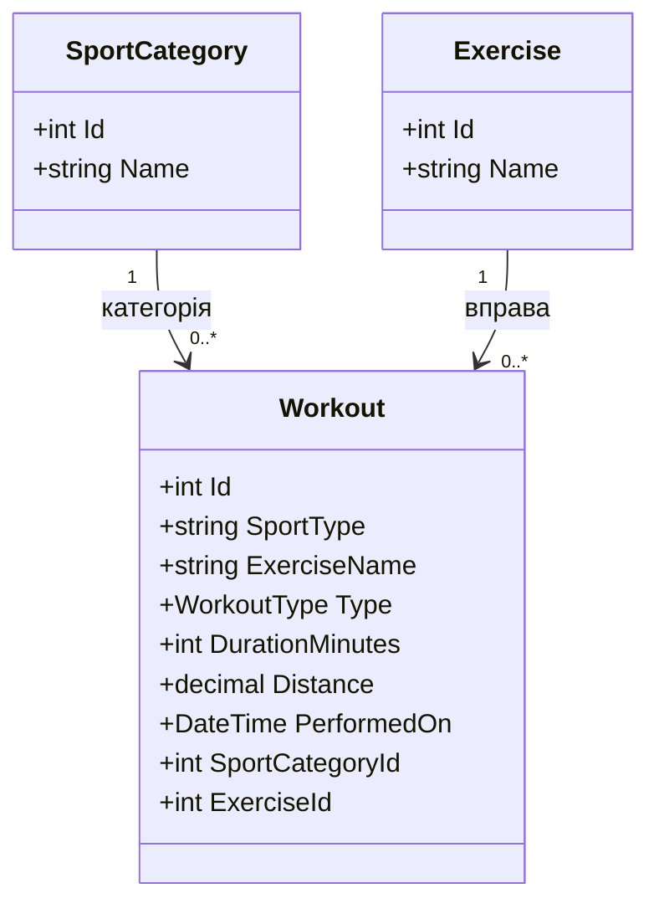

# Щоденник тренувань (TrainingDiary)

## Лабораторна робота №2
Тема: Мова C# і модель предметної області.

## Опис проєкту
TrainingDiary — вебзастосунок Blazor для ведення щоденника тренувань, обліку вправ та аналізу фізичної активності.

## Модель предметної області
Клас Workout містить такі властивості:
- Id (int) — ідентифікатор тренування.
- SportType (string) — вид спорту.
- ExerciseName (string) — назва вправи.
- Type (WorkoutType) — категорія тренування.
- DurationMinutes (int) — тривалість у хвилинах.
- Distance (decimal?) — необов'язкова дистанція.
- PerformedOn (DateTime) — дата тренування.

## Перелік WorkoutType
- Strength — силові тренування.
- Cardio — кардіотренування.
- Recovery — відновлення.
- Other — інші тренування.

## Особливості реалізації
Для Distance використано decimal?, оскільки дистанція потрібна не для кожного тренування.
Для текстових властивостей використано string.Empty.
Дата тренування за замовчуванням — DateTime.Today.

## Перевірка
Команда: dotnet build
Результат: Build succeeded.

## Лабораторна робота №7
### Зв'язки між моделями: довідники та діаграма класів

У проєкті TrainingDiary створено два довідники:
- SportCategory — категорії спорту.
- Exercise — довідник вправ.

Основна модель Workout має зовнішні ключі
SportCategoryId та ExerciseId.

### Діаграма класів

### Результат

Реалізовано зв'язки між моделями Workout,
SportCategory та Exercise.

Створено CRUD-сторінки для двох довідників.
Додано по 5 записів до кожного довідника.

У формах створення та редагування тренувань
додано спадні списки категорій спорту та вправ.

Для відображення пов'язаних даних
використано Include().

Збережено перевірки введених даних,
обробку помилок і пагінацію тренувань.

## Лабораторна робота №8 — LINQ та асинхронний доступ

Реалізовано пошук тренувань за назвою вправи,
фільтрацію за типом і видом спорту,
сортування за датою, тривалістю та назвою.

Використано LINQ, IQueryable, Where, OrderBy,
Skip, Take, CountAsync та ToListAsync.

Додано пошук без урахування регістру,
зокрема для українських назв вправ.

Збережено пагінацію та зв'язки з довідниками.

## Лабораторна робота №9 — Сторінка зведень

Створено сервіс SummaryCalculator із методами:
- BySportAsync — групування за видом спорту.
- ByMonthAsync — групування за роком і місяцем.
- OverallAsync — загальні показники.

Додано сторінку /summary із трьома таблицями.
Для підрахунків використано LINQ GroupBy, Count і Sum.
Запити до SQLite виконуються асинхронно.

Сторінка доступна через пункт меню «Зведення».

## Лабораторна робота №10 — Оформлення та навігація

Покращено інтерфейс TrainingDiary:
- Впорядковано бокове меню.
- Оновлено головну сторінку.
- Додано українські заголовки та кнопки.
- Реалізовано повідомлення про успішні дії.
- Покращено підтвердження видалення.
- Додано порожні стани списків.
- Реалізовано адаптивність на ширині 360 px.
- Додано горизонтальне прокручування таблиць.

Збережено функціональність лабораторних №3–9.

## Лабораторна робота №11 — Мінімальний вебсервіс

У проєкт TrainingDiary додано мінімальний API на ASP.NET Core 10.

### Кінцеві точки

| Метод | Адреса | Призначення |
|---|---|---|
| GET | /api/workouts | Отримати список тренувань |
| GET | /api/workouts/{id} | Отримати тренування за ID |
| GET | /api/summary | Отримати загальну статистику |

### Приклади звернень

GET http://localhost:5030/api/workouts

GET http://localhost:5030/api/workouts/5

GET http://localhost:5030/api/workouts/99999

GET http://localhost:5030/api/summary

### Документація

OpenAPI: http://localhost:5030/openapi/v1.json

Scalar: http://localhost:5030/scalar/v1

### Перевірка

- Дані повертаються у форматі JSON.
- Для існуючого запису повертається HTTP 200.
- Для неіснуючого запису повертається HTTP 404.
- Загальна статистика містить кількість тренувань,
  сумарну та середню тривалість.
- OpenAPI та Scalar доступні у середовищі Development.

## Лабораторна робота №12 — Модульні тести xUnit

Для TrainingDiary створено окремий тестовий проєкт
TrainingDiary.Tests на .NET 10.

### Що перевіряється

1. Порожня база повертає порожній список.
2. Тренування одного виду спорту об'єднуються в одну групу.
3. Тренування різних місяців утворюють окремі групи.
4. Загальний підсумок правильно рахує кількість і тривалість.

### Технології

- xUnit
- Entity Framework Core
- SQLite In-Memory

Тестова база створюється в оперативній пам'яті.
Основна база trainingdiary.db не змінюється.

### Запуск тестів

dotnet test TrainingDiary.slnx

### Результат перевірки

Усього тестів: 4
Пройдено: 4
Помилок: 0
Пропущено: 0

